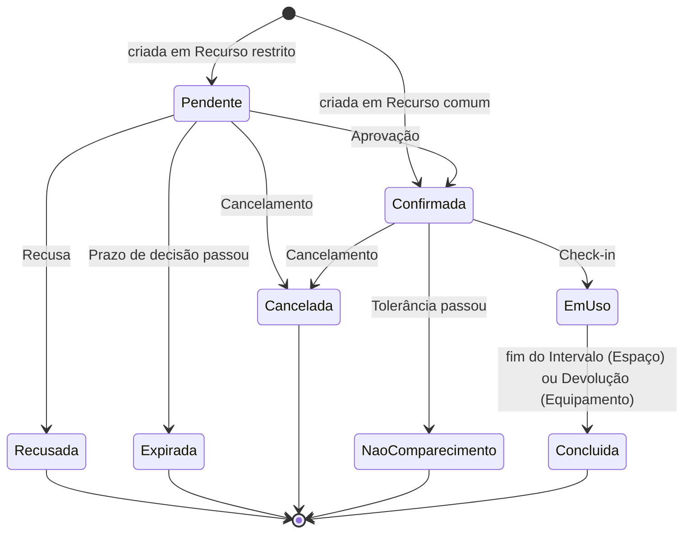

# Requisitos: Reservas do Campus

> **Versão 0.1 (rascunho), 25/10/2026.** Os valores numéricos (prazos, limites, cotas) são **propostas** para o grupo discutir. Todos ficam na Política, então mudar um valor não exige mudar o código.
>
> Os termos em **negrito** seguem o glossário em [`CONTEXT.md`](../CONTEXT.md). Se um termo novo aparecer, ele entra lá primeiro.

## 1. Problema

Hoje a reserva de salas, laboratórios e equipamentos do campus é feita por e-mail, planilha ou no balcão. Isso causa reservas duplicadas, salas reservadas e vazias (ninguém aparece), equipamentos devolvidos com atraso e gestores sem visão do uso dos seus **Recursos**.

O sistema centraliza as **Reservas**, impede **Conflitos** automaticamente, aplica uma **Política** clara por **Perfil** e desestimula o mau uso com **Penalidades** e **Suspensão**.

## 2. Atores

| Ator | O que faz |
|---|---|
| **Aluno** | Busca Recursos, faz Reservas avulsas, faz Check-in, cancela as próprias Reservas |
| **Docente** | Tudo o que o Aluno faz, com limites maiores, e também cria **Séries** |
| **Gestor** | Cadastra os seus Recursos, define Indisponibilidades, decide Pedidos, registra Devoluções |
| **Sistema (relógio)** | Aplica as regras que dependem do tempo: Expiração, Não comparecimento, conclusão automática, fim da Suspensão |

## 3. Escopo

**Dentro do escopo**
- Um único campus, com Espaços e Equipamentos.
- Login simples com e-mail institucional (sem integração real com o login da UNIFESP).
- Notificações dentro do sistema.

**Fora do escopo** (pode virar melhoria futura, se sobrar tempo)
- Integração com o login real da UNIFESP (SSO).
- Envio real de e-mail ou WhatsApp.
- Vários campi.
- Docente "tomar" o horário de um Aluno por prioridade (preempção).
- App mobile nativo (a interface web precisa funcionar no celular).
- Calendário acadêmico (feriados e recessos) cadastrado no sistema. Por enquanto o Docente deixa essas datas de fora ao criar a Série (RN21).

## 4. Módulos e responsáveis

Cada módulo é uma fatia vertical (backend, frontend e testes) com um responsável principal. Os PRs de um módulo são revisados por alguém de **outro** módulo.

| # | Módulo | Conteúdo | Responsável |
|---|---|---|---|
| M1 | **Usuários e conduta** | Login, Perfis, Penalidades, Suspensão, histórico | _a definir_ |
| M2 | **Recursos e disponibilidade** | Cadastro de Recursos, Horário de funcionamento, Indisponibilidade, busca, agenda visual | _a definir_ |
| M3 | **Motor de reservas** | Criação de Reserva e Série, validação de Conflito e da Política, "Minhas reservas" | _a definir_ |
| M4 | **Ciclo de vida** | Aprovação, Recusa, Expiração, Check-in, Não comparecimento, Cancelamento, Devolução, Notificações | _a definir_ |

## 5. Requisitos funcionais (histórias de usuário)

Formato: *Como [ator], quero [ação] para [objetivo].* Cada história tem critérios de aceitação e as regras de negócio (RN) que ela precisa cumprir. **Cada história vira uma ou mais issues no GitHub.**

### M1. Usuários e conduta

**US01: Entrar no sistema.** Como Usuário, quero entrar com meu e-mail institucional para acessar as minhas Reservas.
- Só aceita e-mails `@unifesp.br`.
- O Perfil vem do cadastro: todos os Usuários, com o seu Perfil, já vêm carregados no banco de demonstração. Um e-mail que não está cadastrado não entra, e o Perfil não muda pelo sistema.

**US02: Ver minha conduta.** Como Aluno ou Docente, quero ver minhas Penalidades e se estou suspenso para entender o que posso fazer.
- Mostra cada Penalidade com data, motivo e Reserva de origem.
- Se houver Suspensão, mostra até quando ela vale.
- RN: RN19.

**US03: Suspensão automática.** Como Gestor, quero que quem acumula Penalidades seja suspenso automaticamente para não ter que controlar isso à mão.
- RN: RN19, RN20.

### M2. Recursos e disponibilidade

**US04: Cadastrar Recurso.** Como Gestor, quero cadastrar Espaços e Equipamentos com seus dados para que possam ser reservados.
- Espaço: nome, local, Capacidade, Horário de funcionamento, se é Recurso restrito.
- Equipamento: nome, número de patrimônio (único), Horário de funcionamento, se é Recurso restrito.
- Quem cadastra o Recurso fica como o Gestor responsável por ele (RN13).
- O Gestor só edita os Recursos pelos quais é responsável.

**US05: Cadastrar Indisponibilidade.** Como Gestor, quero marcar um Recurso como indisponível num Intervalo para fazer manutenção ou eventos.
- RN: RN04.

**US06: Buscar Recurso livre.** Como Usuário, quero buscar Recursos por tipo, Capacidade mínima e Intervalo desejado para achar algo livre rápido.
- Só aparecem Recursos sem Conflito, sem Indisponibilidade e dentro do Horário de funcionamento naquele Intervalo.

**US07: Agenda do Recurso.** Como Usuário, quero ver a agenda da semana de um Recurso para escolher um horário livre.
- Mostra ocupado, livre e indisponível. Clicar num horário livre abre a criação de Reserva já preenchida.
- RN: RN22.

### M3. Motor de reservas

**US08: Reservar.** Como Aluno ou Docente, quero reservar um Recurso num Intervalo para garantir o uso.
- Se qualquer regra falhar, a mensagem diz **qual regra** falhou (por exemplo: "Você já tem 3 reservas ativas, o limite do seu perfil é 3").
- Recurso comum → Confirmada. Recurso restrito → Pendente.
- Se o início estiver a menos de 2 horas (dentro do prazo de Cancelamento tardio), a tela avisa antes de confirmar que cancelar já vai gerar Penalidade.
- RN: RN01 a RN10.

**US09: Criar Série.** Como Docente, quero reservar o mesmo Intervalo toda semana até uma data para minhas aulas do semestre.
- Antes de confirmar, a tela mostra todas as datas da Série, e o Docente pode desmarcar as que não quer (feriados, recessos, provas em outro lugar).
- Se alguma data falhar, a resposta lista as datas e a regra que falhou em cada uma. O Docente pode desmarcar essas datas e tentar de novo.
- RN: RN21.

**US10: Minhas reservas.** Como Usuário, quero ver as minhas Reservas futuras e passadas, com o Status de cada uma.

### M4. Ciclo de vida

**US11: Decidir Pedidos.** Como Gestor, quero ver a fila de Pedidos dos meus Recursos e aprovar ou recusar cada um.
- A fila vem ordenada pelo início do Intervalo (o mais urgente primeiro).
- Se quem pediu está com Suspensão em vigor, o Pedido mostra "Usuário suspenso até DD/MM". O Gestor pode aprovar normalmente ou recusar com justificativa; nada é automático.
- Os Pedidos de uma mesma Série aparecem como um item só, com as datas, e são decididos juntos (RN21).
- RN: RN11, RN12, RN13.

**US12: Fazer Check-in.** Como Usuário, quero registrar que cheguei ou retirei o Equipamento para não perder a Reserva.
- RN: RN14.

**US13: Cancelar.** Como Usuário, quero cancelar uma Reserva para liberar o Recurso.
- RN: RN16.

**US14: Registrar Devolução.** Como Gestor, quero registrar que o Equipamento voltou para encerrar a Reserva.
- RN: RN17.

**US15: Regras automáticas de tempo.** Como Sistema, quero aplicar Expiração, Não comparecimento e conclusão automática no momento certo.
- RN: RN12, RN15, RN18.

**US16: Notificações.** Como Usuário, quero ser avisado do que acontece com minhas Reservas para não ser pego de surpresa.
- Eventos: Aprovação, Recusa (com justificativa), Expiração, Cancelamento pelo sistema, Penalidade, início e fim de Suspensão, lembrete 1h antes do início.

## 6. Regras de negócio

Cada RN precisa de **pelo menos um teste automatizado** com o ID dela no nome (por exemplo `RN01_nao_permite_conflito`). Os exemplos abaixo já são casos de teste prontos.

### Intervalo e disponibilidade

**RN01: Sem Conflito.** Uma Reserva não pode ser criada se o Intervalo dela se sobrepõe ao de outra Reserva ativa do mesmo Recurso.
- Existe 10h–12h. Pedir 11h–13h → **recusado**. Pedir 12h–14h → **aceito** (só se encostam).
- Existe 10h–12h **Cancelada**. Pedir 10h–12h → **aceito** (Reserva cancelada não ocupa).

**RN02: Intervalo válido.** O fim é depois do início, os dois ficam no mesmo dia e as duas pontas são múltiplos de 30 minutos.
- 10h–10h → recusado. 10h15–11h → recusado. 22h–01h → recusado.

**RN03: Dentro do Horário de funcionamento.** O Intervalo inteiro precisa caber no Horário de funcionamento do Recurso.
- Funcionamento 7h–23h. Pedir 22h–23h30 → recusado.

**RN04: Indisponibilidade.** Não é possível reservar um Intervalo que se sobrepõe a uma Indisponibilidade. Quando um Gestor cria uma Indisponibilidade em cima de Reservas ativas, essas Reservas recebem Cancelamento pelo sistema, **sem Penalidade**, e o Usuário recebe uma Notificação.

### Política

| Limite | Aluno | Docente |
|---|---|---|
| Antecedência mínima | 1 hora | 1 hora |
| Antecedência mínima em Recurso restrito | 24 horas | 24 horas |
| Antecedência máxima | 14 dias | 60 dias |
| Duração máxima (Espaço) | 2 horas | 4 horas |
| Duração máxima (Equipamento) | 4 horas | 8 horas |
| Cota (Reservas ativas) | 3 | 10 |
| Tolerância do Check-in | 15 min | 15 min |
| Cancelamento sem Penalidade | até 2h antes do início | até 2h antes do início |
| Suspensão | 3 Penalidades em 30 dias → 7 dias | igual |

Valores da tabela confirmados no ticket [Regras de conduta e valores da Política](https://github.com/tapajosgustavo-collab/reservas-campus/issues/6).

A Antecedência mínima em Recurso restrito foi decidida no ticket [Regras de Pedido e ocupação](https://github.com/tapajosgustavo-collab/reservas-campus/issues/4).

O Gestor não cria Reservas: para eventos institucionais ele usa Indisponibilidade.

**RN05: Antecedência.** O início do Intervalo fica entre a Antecedência mínima e a máxima do Perfil, contadas a partir de agora. Em Recurso restrito vale a Antecedência mínima em Recurso restrito (24h), para o Gestor sempre ter tempo de decidir antes do Prazo de decisão (RN12).
- Aluno, agora 25/10 às 9h. Pedir 25/10 às 9h30 → recusado (menos de 1h). Pedir 10/11 → recusado (mais de 14 dias).
- Aluno, agora 25/10 às 12h30. Pedir um laboratório restrito para 25/10 às 14h → recusado (menos de 24h). Pedir para 26/10 às 14h → aceito, nasce Pendente.

**RN06: Duração máxima.** A duração do Intervalo não passa da Duração máxima do Perfil para aquele tipo de Recurso.
- Aluno pede sala por 2h30 → recusado. Docente pede a mesma sala por 2h30 → aceito.
- Aluno reserva a sala 10h–12h e depois 12h–14h → as duas são aceitas (Reservas seguidas são permitidas; cada uma conta 1 na Cota).

**RN07: Cota.** O Usuário não pode passar da Cota de Reservas ativas do Perfil dele.
- Aluno com 3 Reservas ativas tenta a 4ª → recusado. Cancela uma e tenta de novo → aceito.
- Docente com 4 Séries ativas (de 18 Ocorrências cada) e 5 Reservas avulsas ativas usa 9 de 10. Pode criar mais uma Reserva avulsa ou mais uma Série (RN21).

**RN08: Capacidade.** Ao reservar um Espaço, o Usuário informa o número de participantes, que não pode passar da Capacidade.

**RN09: Suspenso não reserva.** Um Usuário com Suspensão em vigor não pode criar Reservas nem Séries.

**RN10: Restrito começa Pendente.** A Reserva em Recurso restrito nasce Pendente. Nos demais Recursos, nasce Confirmada. **Uma Reserva Pendente já ocupa o Intervalo**: quem pediu primeiro tem a vez, e o Pedido conta na Cota como qualquer Reserva ativa.
- Ana pede o laboratório restrito para terça 14h–16h às 8h. Bruno pede o mesmo Intervalo às 9h → **recusado** por Conflito (RN01).
- O Gestor recusa o Pedido da Ana, ou ele expira → o Intervalo fica livre. Bruno pede de novo → aceito, nasce Pendente. Não existe fila de espera.

### Pedidos

**RN11: Recusa justificada.** O Gestor só consegue recusar um Pedido se escrever uma justificativa, que vai na Notificação.

**RN12: Expiração.** Se o Pedido não for decidido até **2 horas antes do início**, ele vira Expirado automaticamente, libera o Intervalo e o Usuário é notificado. Expiração não gera Penalidade.

**RN13: Gestor do Recurso.** Cada Recurso tem exatamente um Gestor responsável: o Gestor que o cadastrou. Só ele decide os Pedidos do Recurso.
- Carlos cadastra o projetor P-123. Dora, que também é Gestora, tenta aprovar um Pedido do P-123 → recusado.

### Uso

**RN14: Janela de Check-in.** O Check-in é aceito de 15 minutos antes do início até o fim da Tolerância (15 minutos depois do início), e só pelo dono da Reserva. Reserva Pendente não aceita Check-in.
- Reserva às 10h. Check-in às 9h40 → recusado. 9h50 → aceito. 10h14 → aceito. 10h16 → recusado.

**RN15: Não comparecimento.** Uma Reserva Confirmada sem Check-in até o fim da Tolerância vira Não comparecimento, libera o restante do Intervalo para outras Reservas e gera uma Penalidade.

**RN16: Cancelamento.** O Usuário pode cancelar Reservas Pendentes ou Confirmadas até o início do Intervalo. Cancelar uma Reserva **Confirmada** com menos de 2 horas de antecedência é Cancelamento tardio e gera Penalidade. Cancelar uma Pendente nunca gera Penalidade.

**RN17: Devolução atrasada.** Uma Reserva de Equipamento só termina com a Devolução. Se a Devolução for registrada depois do fim do Intervalo, o Usuário recebe uma Penalidade.

**RN18: Conclusão automática.** Uma Reserva de Espaço Em uso vira Concluída automaticamente no fim do Intervalo.

### Conduta

**RN19: Suspensão.** Quando o Usuário chega a **3 Penalidades nos últimos 30 dias**, ele fica suspenso por **7 dias** a partir da 3ª. Vale igual para Aluno e Docente. Os 30 dias são uma janela móvel, contada para trás a partir de cada nova Penalidade. A Penalidade nunca sai do histórico; ela só deixa de contar depois de 30 dias ou depois de causar uma Suspensão (RN20).
- As Reservas que ele já tinha continuam valendo: ele ainda pode fazer Check-in, cancelar, e os Pedidos Pendentes dele ainda podem ser aprovados.
- Penalidades recebidas durante a Suspensão contam normalmente. Suspenso de 01/11 a 08/11, falta às 3 Reservas que já tinha (02, 03 e 04/11) → nova Suspensão de 7 dias a partir da 3ª, e o fim passa a ser 11/11. Se uma nova Suspensão terminasse antes da atual, vale o fim mais distante.

**RN20: Penalidade conta uma vez.** As Penalidades que já causaram uma Suspensão não contam para a próxima.
- 3 Penalidades → suspenso. Volta, leva a 4ª Penalidade dentro dos mesmos 30 dias → **não** é suspenso de novo (conta só 1).

### Séries

**RN21: Série tudo-ou-nada.** Só Docentes criam Séries. A Série repete o mesmo Intervalo toda semana até uma data final de no máximo 18 semanas depois. Cada Ocorrência passa pelas RN01 a RN09, **exceto a Antecedência máxima**. Se **qualquer** Ocorrência falhar, nenhuma é criada, e a resposta lista quais datas falharam e por quê. Decidido no ticket [Séries e Cota](https://github.com/tapajosgustavo-collab/reservas-campus/issues/7):
- **Datas de fora.** Na criação, o Docente pode desmarcar datas. As datas desmarcadas não viram Ocorrência e não são validadas; o tudo-ou-nada vale só para as datas que sobraram. O sistema não conhece o calendário acadêmico: feriados e recessos são desmarcados pelo Docente na criação ou cancelados depois.
  - Série de terça de 04/08 a 01/12 com 17/11 desmarcada → 17 Ocorrências; 17/11 nem é validada, mesmo que exista Indisponibilidade nesse dia.
- **Cota.** A Série conta como **1** na Cota, junto com as Reservas avulsas, enquanto tiver pelo menos uma Ocorrência ativa. Cancelar uma Ocorrência só não devolve nada da Cota; a Série só deixa de contar quando nenhuma Ocorrência dela está mais ativa.
- **Cada Ocorrência é uma Reserva comum.** Depois de criada, cada Ocorrência segue o ciclo de vida normal: Check-in, Não comparecimento e Cancelamento tardio geram Penalidade como numa Reserva avulsa (RN15, RN16). O Docente pode cancelar uma Ocorrência só ou a Série inteira a partir de uma data; cada Ocorrência cancelada segue a RN16.
  - O Docente esquece de cancelar a Ocorrência de um feriado e não faz Check-in → Não comparecimento e Penalidade.
- **Série em Recurso restrito.** As Ocorrências nascem Pendentes (RN10) e o Gestor decide a Série inteira de uma vez: a Aprovação confirma todas as Ocorrências Pendentes, e a Recusa (com justificativa, RN11) recusa todas. Se ninguém decidir até o Prazo de decisão da primeira Ocorrência, todas expiram juntas (RN12). Depois de decididas, as Ocorrências seguem cada uma a sua vida.

### Privacidade

**RN22: Agenda sem nomes.** A agenda pública de um Recurso mostra só livre, ocupado e indisponível. Quem reservou só aparece para o próprio Usuário e para o Gestor do Recurso.

## 7. Ciclo de vida da Reserva

Reservas ativas: **Pendente, Confirmada e Em uso.**

## 8. Requisitos não funcionais

| ID | Requisito |
|---|---|
| RNF01 | Toda RN tem teste unitário com o ID dela no nome. Cobertura mínima de 80% no código das regras de negócio. |
| RNF02 | As regras que dependem do tempo recebem o "agora" de fora (relógio injetável), para os testes poderem simular qualquer data e hora. |
| RNF03 | Testes de integração na API para cada história e testes ponta a ponta para os 3 fluxos principais: reservar, decidir Pedido, Check-in. |
| RNF04 | Todo PR roda lint e testes no GitHub Actions. Nada entra na `main` com o CI falhando ou sem 1 aprovação. |
| RNF05 | O projeto sobe com um comando (por exemplo `docker compose up`) e o README explica como rodar e testar. |
| RNF06 | A API é documentada (OpenAPI/Swagger). |
| RNF07 | A interface funciona no celular e no computador. |
| RNF08 | Todas as datas usam o fuso `America/Sao_Paulo`. |
| RNF09 | As mensagens de erro são em português e dizem qual regra impediu a ação. |
| RNF10 | Banco carregado com dados de demonstração (Usuários de cada Perfil, Recursos, Reservas) para a apresentação. |

## 9. Entregas incrementais

Cada incremento termina com uma release (tag) no GitHub e algo funcionando de ponta a ponta.

| Incremento | Entrega | RNs |
|---|---|---|
| 0. Fundação | Repositório, CI, esqueleto de back e front, banco, README, este documento | — |
| 1. MVP | Login, cadastro de Recurso, reservar, minhas reservas, agenda simples | RN01–RN03 |
| 2. Política | Antecedência, duração, Cota, Capacidade, Cancelamento, Indisponibilidade | RN04–RN08, RN16 (sem Penalidade ainda) |
| 3. Pedidos | Recursos restritos, fila do Gestor, Aprovação, Recusa, Expiração, Notificações | RN10–RN13 |
| 4. Conduta | Check-in, Não comparecimento, Devolução, Penalidade, Suspensão | RN09, RN14–RN20 |
| 5. Séries e polimento | Séries, privacidade da agenda, testes ponta a ponta, ensaio da apresentação | RN21, RN22 |

## 10. Questões em aberto

Decisões que o grupo precisa tomar. A proposta atual está entre parênteses e já está aplicada no documento acima.

1. ~~**Pedido Pendente ocupa o horário?**~~ **Decidido** ([#4](https://github.com/tapajosgustavo-collab/reservas-campus/issues/4)): sim, quem pediu primeiro tem a vez, sem fila de espera (RN10). Vários Pedidos para o Gestor escolher fica como melhoria futura.
2. **Equipamentos iguais.** O campus tem 5 projetores idênticos. O Usuário escolhe "o projetor de patrimônio 123" ou só "um projetor"? (Proposta: cada Equipamento é uma unidade e o Usuário escolhe qual. "Qualquer um livre" seria uma melhoria futura.)
3. **Equipamento não devolvido.** O notebook da Reserva das 10h–12h não voltou, e outra pessoa tem Reserva às 13h. O que acontece com ela? (Proposta: o Check-in dela fica bloqueado até a Devolução, ela não leva Penalidade e o Gestor é notificado.)
4. ~~**Docente leva Penalidade?**~~ **Decidido** ([#6](https://github.com/tapajosgustavo-collab/reservas-campus/issues/6)): sim, mesmas regras do Aluno.
5. ~~**Suspensão e Reservas futuras.**~~ **Decidido** ([#6](https://github.com/tapajosgustavo-collab/reservas-campus/issues/6)): elas continuam valendo (RN19).
6. ~~**Série na Cota.**~~ **Decidido** ([#7](https://github.com/tapajosgustavo-collab/reservas-campus/issues/7)): a Série conta como 1 na Cota enquanto tiver alguma Ocorrência ativa (RN21).
7. ~~**Quem define que alguém é Docente ou Gestor?**~~ **Decidido** ([#4](https://github.com/tapajosgustavo-collab/reservas-campus/issues/4)): todos os Usuários e Perfis vêm do banco de demonstração e o Perfil não muda pelo sistema (US01). Cada Recurso tem um único Gestor responsável, quem o cadastrou (RN13). Tela de administração fica para depois.
